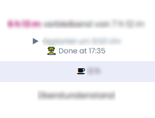

# Timebutler End of Day

Displays the estimated end of your work day on Timebutler's dashboard.
Worktime can be customized for each weekday.

For planned extra hours, a custom time goal can be set to be displayed alongside the required time.

Uses your browser's locale for clock-time format.

